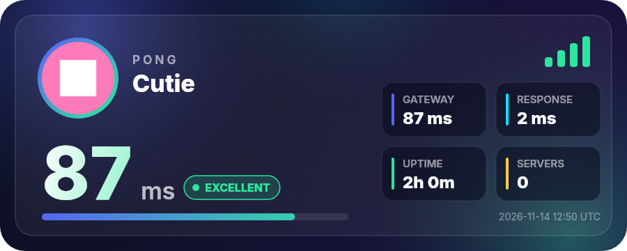
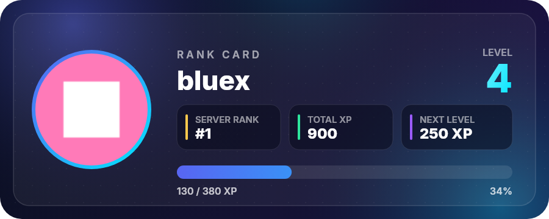
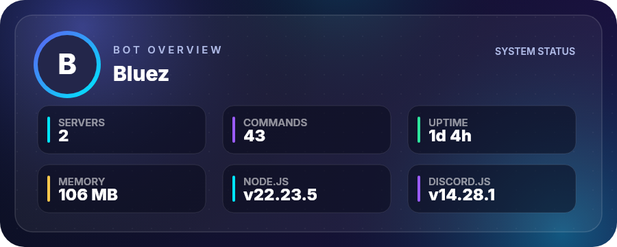
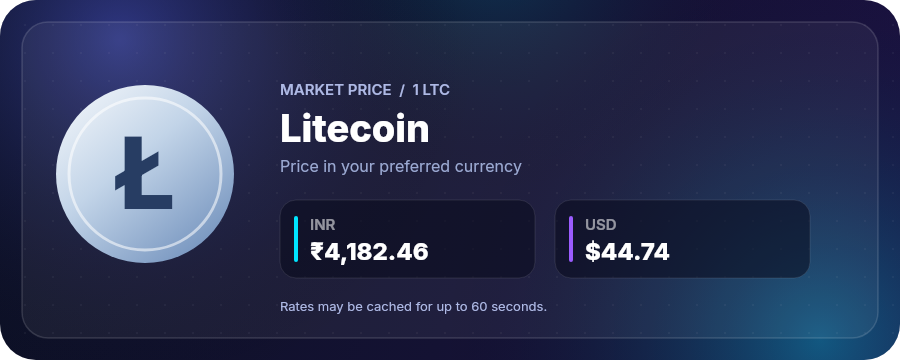
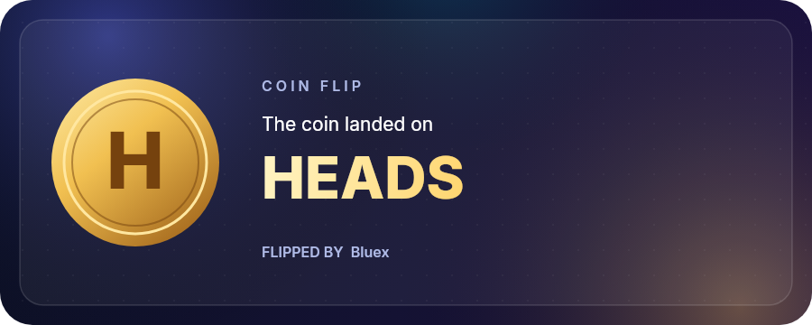
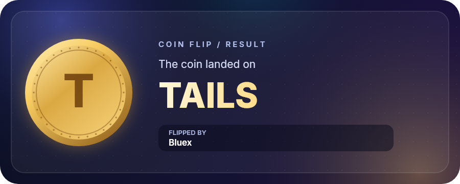

# 🤖 Premium Discord Bot

A feature-rich Discord bot built with **Node.js + discord.js v14**. Slash and `!` prefix commands, premium embeds and image cards, JSON file storage, and a one-click installer.

> **No Docker.** The bot runs natively (`node index.js` / `npm start`) and is kept online 24/7 by **PM2**.

<a id="fresh-vps-install"></a>
## 🚀 Fresh VPS: all-in-one install

For a **new Ubuntu/Debian VPS**, run this single command in a terminal. It installs Git if needed, clones the latest `main` branch into `~/bluez`, and runs the interactive setup script:

```bash
cd ~ && (command -v git >/dev/null || { if [ "$(id -u)" -eq 0 ]; then apt-get update && apt-get install -y git ca-certificates; else sudo apt-get update && sudo apt-get install -y git ca-certificates; fi; }) && git clone --branch main https://github.com/siddhantpashte123-hub/bluez.git bluez && cd bluez && bash setup.sh
```

- This is for a **fresh install**: `~/bluez` must not already exist. For an existing installation, use the [update command](#updating-the-bot) instead.
- Requires internet access and, if Git needs installing, root or working `sudo` access. Setup installs Node.js, dependencies and PM2 if needed.
- When prompted, enter your bot token **only in your VPS terminal**; never post it in chat. Create the bot, enable the two privileged intents and invite it as explained below.
- A fresh VPS does **not** contain your old bot data. If migrating, securely back up and transfer the old `data/` folder separately.
- On systems without systemd, automatic startup may not be available; after a restart, use `pm2 resurrect`.

---

## ✨ Features

| Category | Command | What it does |
| --- | --- | --- |
| 🛡️ Moderation | `/purge <amount>` | Bulk delete up to 100 messages (needs **Manage Messages**) |
| | `/channel rename <new_name>` | Rename the current channel (needs **Manage Channels**) |
| | `/dm <user> <message>` | DM one member through the bot (needs **Manage Server**) |
| | `/dmall <message>` | DM every member with a live progress embed (needs **Administrator**) |
| 🧰 Utility | `/upiqr <upi_id> <amount> <name>` | UPI payment QR. Amounts above ₹2,000 are split into several QR codes |
| | `/afk <reason>` | Set AFK. The bot replies when you are pinged and clears AFK when you talk |
| 🔊 Voice | `/247 vc join <voice_channel>` | Join a voice channel and stay there 24/7 with auto-reconnect |
| | `/247 vc stop` | Leave and turn 24/7 mode off |
| 🤖 Automation | `/autoresponder set / remove / list` | Auto-reply to keywords (needs **Manage Server**) |
| | `/auto reacter set / remove / list` | Auto-react to keywords, custom emojis supported (needs **Manage Server**) |
| 🎵 Music | `/music play <song>` | Play a song by name or link, or add it to the queue |
| | `/music pause / resume / skip / stop` | Playback controls (also available as buttons) |
| | `/music queue / nowplaying / shuffle / loop` | Queue tools and repeat modes |
| 🎁 Giveaways | `/gcreate <prize> <duration> [winners] [channel]` | Start a giveaway with an **Enter** button (needs **Manage Server**) |
| | `/gend [message_id]` | End a giveaway now and pick the winner(s) |
| | `/greroll [message_id] [winners]` | Pick new winner(s) for an ended giveaway |
| 🎫 Tickets | `/ticket setup [channel] [category] [support_role]` | Post the ticket panel with a **Create Ticket** button (needs **Manage Server**) |
| | `/ticket close` | Close the ticket you are in (owner or support team) |
| | `/ticket add / remove <user>` | Add or remove a member from the current ticket (support team) |
| 📊 Info | `/invites` | Invite leaderboard, top 10 with 🥇🥈🥉 |
| | `/invited <user>` | A member's invite count and invite codes |
| | `/userinfo [user]` | A member's profile: ID, join date, roles |
| | `/help` | Multi-page help menu with button navigation |

---

## 1️⃣ Create the bot and get the token

1. Open the **[Discord Developer Portal](https://discord.com/developers/applications)** and log in.
2. Click **New Application**, give it a name, and click **Create**.
3. Open the **Bot** tab on the left.
4. Click **Reset Token** → **Yes, do it!** → **Copy**. This is your **bot token**.
   Keep it secret. Anyone who has it controls your bot. If it leaks, press **Reset Token** again.

## 2️⃣ Enable the privileged intents (required)

Still on the **Bot** tab, scroll to **Privileged Gateway Intents** and switch **ON**:

| Intent | Needed for |
| --- | --- |
| ✅ **MESSAGE CONTENT INTENT** | Autoresponder, auto reacter and AFK (the bot must read messages) |
| ✅ **SERVER MEMBERS INTENT** | `/dmall` and invite tracking |

Click **Save Changes**. Without these the bot will refuse to start (`Used disallowed intents`).

## 3️⃣ Invite the bot to your server

1. Open **OAuth2 → URL Generator**.
2. Scopes: tick **`bot`** and **`applications.commands`**.
3. Bot permissions: tick **Administrator** (simplest), or at least:
   View Channels, Send Messages, Embed Links, Attach Files, Read Message History, Add Reactions,
   Use External Emojis, Manage Messages, Manage Channels, Manage Roles, Manage Server, Create Invite, Connect, Speak.
4. Open the generated URL and add the bot to your server.

## 4️⃣ One-click setup

Copy the project folder to your VPS, then:

### 🪟 Windows VPS

Double-click **`setup.bat`**.

### 🐧 Linux VPS (Ubuntu / Debian)

For a fresh machine, use the [all-in-one install command](#fresh-vps-install) above. If you already copied the project folder, run:

```bash
chmod +x setup.sh
./setup.sh
```

Both scripts do the same thing, automatically:

1. Check for **Node.js v20+** and silently install Node.js LTS if it is missing (Linux: package repository first, official nodejs.org binary as automatic fallback).
2. Run `npm install`.
3. Ask: `Paste your Discord Bot Token:` and save it to `.env` as `DISCORD_TOKEN=...`.
4. Install **PM2**, start the bot as `DiscordBot`, run `pm2 save`, and attempt to register auto-start on reboot when systemd is available.
5. Print `✅ Bot is now running 24/7. Token saved. Done.`

That is it. Type `/help` in your server.

> Slash commands are registered **globally**. The first time, Discord can take a few minutes to show them. Restart your Discord app (Ctrl+R) if they do not appear.

---

## 🔁 Managing the bot with PM2

```bash
pm2 status                 # is it online?
pm2 logs DiscordBot        # live logs (Ctrl+C to exit)
pm2 restart DiscordBot     # restart
pm2 stop DiscordBot        # stop
pm2 start DiscordBot       # start again
pm2 delete DiscordBot      # remove from PM2
```

### Updating the bot

For an existing Git installation at `~/bluez`, update to the latest merged `main` version and restart PM2:

```bash
cd ~/bluez && git checkout main && git pull --ff-only origin main && npm install && pm2 restart DiscordBot
```

Keep your `.env` file and `data/` folder. If Git reports conflicting local changes, review them before updating; do not delete them just to make the command run.

### Changing the token

Run the setup script again and answer **n** when asked to keep the existing token,
or edit `.env` by hand and run `pm2 restart DiscordBot`.

### Running without PM2 (for testing)

```bash
npm start      # same as: node index.js
```

---

## 📂 Project structure

```
/
├── index.js                 # entry point: client, loaders, login
├── .env.example             # template for the token file
├── package.json
├── setup.bat                # one-click setup (Windows)
├── setup.sh                 # one-click setup (Linux)
├── README.md
├── commands/
│   ├── dm.js
│   ├── dmall.js
│   ├── purge.js
│   ├── invites.js
│   ├── invited.js
│   ├── gcreate.js           # giveaways (+ gend.js, greroll.js)
│   ├── gend.js
│   ├── greroll.js
│   ├── music.js
│   ├── upiqr.js
│   ├── help.js
│   ├── afk.js
│   ├── 247vc.js
│   ├── channelrename.js
│   ├── autoresponder.js
│   ├── autoreacter.js
│   ├── ticket.js
│   └── userinfo.js
├── events/
│   ├── ready.js             # registers commands, invite sync, rejoins 24/7 VCs
│   ├── interactionCreate.js # command router + error embeds
│   ├── messageCreate.js     # AFK, autoresponder, auto reacter
│   └── voiceStateUpdate.js  # 24/7 VC auto-reconnect
├── utils/
│   ├── embeds.js            # shared premium embed builder
│   └── db.js                # tiny JSON database
└── data/                    # per-server storage (back this folder up)
    ├── autoresponder.json
    ├── reacter.json
    ├── afk.json
    ├── invites.json
    ├── 247vc.json
    ├── giveaways.json
    └── tickets.json
```

---

## 🎁 Giveaways

- `/gcreate prize:Nitro duration:1d12h winners:2` posts the giveaway. Durations use `s`, `m`, `h`, `d`, `w` (10 seconds to 30 days).
- Members press **Enter Giveaway** to join and press it again to leave.
- When the time is up the bot picks random winners, edits the message and pings them. This also works if the bot was restarted in between.
- The winner announcement has a **Claim Prize** button. Only the winner(s) can use it. It opens a private ticket with the winner and the giveaway host (plus the support role if `/ticket setup` was used). The bot needs **Manage Channels** and **Manage Roles** for this.
- `/gend` ends a giveaway early. `/greroll` picks new winners; ended giveaways can be rerolled for 7 days.
- Without a `message_id`, `/gend` and `/greroll` use the newest giveaway in the current channel.

## 🎵 Music

- Join a voice channel and run `/music play song:<name or link>`. Song names are searched on YouTube first and on SoundCloud as a backup. Direct links work for the sites supported by yt-dlp.
- The "Now Playing" message has buttons for pause, skip, loop, queue and stop. You must be in the bot's voice channel to use them.
- The bot leaves 3 minutes after the queue ends. If 24/7 mode is on, music plays in the 24/7 channel and the bot stays there afterwards.
- **yt-dlp** is downloaded automatically into `bin/` the first time a song is played, and refreshed weekly. **FFmpeg** comes from the `ffmpeg-static` package; if that is missing, install it with `sudo apt install -y ffmpeg`.
- Playlists are not supported; a playlist link plays only the linked song.
- YouTube often blocks requests from VPS / datacenter IP addresses ("Sign in to confirm you're not a bot", HTTP 403). When a song cannot be loaded, the bot plays the closest match from SoundCloud instead and shows the reason. SoundCloud links always skip YouTube.
- Optional: to make YouTube work on a blocked server, export your YouTube cookies in Netscape format to a file named `cookies.txt` next to `index.js` and restart the bot. Use a spare Google account, because YouTube can restrict accounts used this way.

## 🎫 Ticket system

1. Give the bot's role **Manage Channels** and **Manage Roles** (or Administrator).
2. Run `/ticket setup`. All options are optional:
   - `channel`: where the panel is posted (default: the current channel)
   - `category`: where ticket channels are created
   - `support_role`: the role that can see and answer every ticket
3. Members press **Support**, **Buy** or **Report**. The bot creates a private channel that only the member, the support role and the bot can see.
4. Close a ticket with the **Close Ticket** button or `/ticket close`. The channel is deleted 5 seconds after confirming.

Each member can have one open ticket. The panel button keeps working after a bot restart.

## 🧩 More features (moderation, welcome, levels, shop…)

Everything below is switched **off** until you set it up. Quick setup commands:

| Feature | Setup |
| --- | --- |
| Mod logs (deleted/edited messages, joins, leaves, mod actions, ticket transcripts, paid orders) | `/logs set channel:#logs` |
| Moderation | `/mod ban`, `kick`, `timeout`, `untimeout`, `warn`, `warnings`, `clearwarns`, `lock`, `unlock`, `slowmode` |
| Automod (invite links, mass mentions, spam, bad words) | `/automod set rule:… enabled:True`, `/automod word action:add word:…` |
| Raid protection | `/antiraid set enabled:True min_account_age_days:3 join_limit:8` |
| Welcome / goodbye / auto-role | `/welcome set`, `/welcome goodbye`, `/welcome autorole` (placeholders: `{user}`, `{server}`, `{count}`) |
| Self-roles and verification | `/roles panel`, `/roles verify role:@Member` |
| Invite reward roles | `/inviterewards set invites:5 role:@Inviter` |
| Levels / XP | `/level toggle enabled:True`, `/level reward level:5 role:@Active`, `/level rank`, `/level leaderboard` |
| Economy (game coins) | `/eco daily`, `work`, `balance`, `pay`, `leaderboard` |
| Polls and suggestions | `/poll question:… options:A \| B \| C`, `/suggest setup channel:#suggestions`, `/suggest idea` |
| Reminders and birthdays | `/remind in:2h text:…`, `/birthday channel`, `/birthday set` |
| Fun and info | `/fun 8ball\|coinflip\|dice\|choose`, `/info server\|avatar\|ping\|bot`, `/embed` |
| Shop with UPI order tickets | `/shop setup upi_id:name@bank name:…` → `/shop add` → `/shop panel` |
| Litecoin (LTC) payments | `/shop ltc address:ltc1…` (order tickets), `/ltc qr`, `/ltc price`, `/ltc check` |
| Calculator | `/calc expression:1999 * 3 + 18%` |
| Vouches (reviews) | `/vouch channel`, `/vouch give stars:5 review:…`, `/vouch stats` |

**Shop flow:** a member presses a product button → a private `order-…` ticket opens → the bot posts the UPI QR for the price → the member pays and sends a screenshot → staff presses **Mark as Paid** (stock goes down by one, the order is written to the log channel).
A bot **cannot verify UPI payments**. Staff must check their own UPI app before pressing the button.

**Litecoin:** after `/shop ltc`, every order ticket gets a **Pay with LTC** button. The bot converts the ₹ price to LTC at the live rate and posts the address + QR. The buyer pays, presses **I Have Paid — Verify** and pastes the transaction ID. The bot checks the transaction on public block explorers: it must pay the shop address, be at least 99% of the amount, be newer than the order, have 1 confirmation and must not have been used for another order. Only then the order is marked as paid automatically. The bot never holds coins or keys — payments go straight to your own address. Double-check that address: crypto sent to a wrong address cannot be recovered.

**Tickets:** the panel has **Support / Buy / Report** buttons, staff can **Claim** a ticket, and an **HTML transcript** (Discord-styled, opens in any browser, up to 2,000 messages) is sent as a compact file card to the ticket owner by DM and to the log channel when the ticket is closed. Run `/ticket setup` again to get the new panel.

**Giveaways:** `/gcreate` accepts `required_role`, `min_invites` and `bonus_role` (2x chance).

**Music:** `/music volume percent:…` (applies from the next song).

**Permissions the bot role needs for these features:** Kick Members, Ban Members, Timeout Members, Manage Messages, Manage Roles, Manage Channels, Manage Server (invite tracking). The bot's role must be **above** every role it should give out.

Settings and data of these features are stored in `data/*.json` (created automatically, not part of the Git repository — back up the `data/` folder).

---

## 🖼️ Image cards

`/info ping`, `/level rank`, `/info bot`, `/ltc price` and `/fun coinflip` have drawn image cards. The last three also keep their readable embed details:








Preview values are illustrative, not live prices.

- Drawn with `@napi-rs/canvas` (installed by `npm install`, no system packages needed). The Inter font is bundled in `assets/fonts`, so it also works on a VPS without any fonts.
- If the package cannot be installed, these commands fall back to their normal embed. The three new cards also retry with an embed if an attachment cannot be sent. LTC prices use the existing provider and can be cached for up to 60 seconds.
- Coin flips use one independent 50/50 draw for each command; consecutive identical results are possible. The image and text always show the same result.
- Names are drawn with Latin/Greek/Cyrillic letters only; emojis and other scripts are left out of the image.

---

## ❗ Prefix commands (`!`)

Every command works as a slash command **and** with the prefix `!`:

```
!help
!calc 1999 * 3 + 18%
!remind 10m drink water
!mod warn @user stop spamming
!gcreate "Nitro Classic" 1d 2
!announce Server is back online! #news @News
!embed title:Hello description:Welcome to the server color:#ff0000 footer:Team
```

- Options are written **in order**. Text with spaces goes in `"quotes"`; the last required text option takes everything that is left.
- Optional text options are written **by name** (`name:value`), with the same names the slash command shows.
- Wrong input shows the usage of the command. `!command` without a subcommand lists its subcommands.
- The permission a slash command needs is also required for the prefix version.
- Replies that are "only visible to you" with slash commands are normal replies with the prefix.
- The prefix needs the **Message Content** intent (already required above). To change it, edit `PREFIX` in `utils/prefix.js`.

`/announce message [title] [channel] [ping] [role] [image] [color]` posts an announcement embed and can ping `@everyone`, `@here` or a role (needs Manage Server; for pings both you and the bot need "Mention @everyone, @here and All Roles").

---

## 😀 Custom emojis

The bot uses five custom emojis (tick, caution, two gifts, bow). Their IDs are listed at the top of `utils/embeds.js`.

- Upload them under **Developer Portal → your application → Emojis**, for the **same application** whose token the bot uses. Emojis from a server the bot is in also work.
- On startup the log shows `Custom emojis loaded: 5/5`. Any emoji that cannot be found is replaced by a normal emoji (✅ ⚠️ 🎁 🎀), so nothing breaks.
- To add or change one, edit the `EMOJIS` list in `utils/embeds.js` and use it in code with `embeds.e('key')`.

## 📝 Good to know

- **`/24/7 vc` is typed as `/247 vc join` and `/247 vc stop`.** Discord does not allow `/` or spaces inside a command name, and a command cannot have a channel option and a subcommand at the same level.
- **24/7 voice** plays a looped silent track. With Node.js 22.12+ and a working `ffmpeg-static` binary it uses `discord-audio-stream`; otherwise it falls back automatically to a built-in silent Opus stream from `@discordjs/voice`. Saved channels are rejoined on startup, on disconnect, and by a 60-second watchdog.
- **`/dmall`** sends one DM every 1.5 seconds and skips bots. Members with closed DMs are counted as failed. Discord treats unsolicited mass DMs as spam and can quarantine or ban bots that abuse this, so use it only for real announcements in your own server.
- **`/upiqr`**: Discord embeds cannot make `upi://` links clickable, so the "Pay Now" link is shown as copyable text next to the QR code. Maximum amount is ₹50,000 per command.
- **`/invites`** needs the bot to have **Manage Server** to read invite links. Counts are saved in `data/invites.json`, so they survive deleted or expired links.
- **`/channel rename`**: Discord allows only 2 renames per channel every 10 minutes.
- The token is read only from `.env`. It is never hard-coded and never written to the logs. `.env` is in `.gitignore`.

## 🛠️ Troubleshooting

| Problem | Fix |
| --- | --- |
| `Used disallowed intents` in the logs | Enable both privileged intents (step 2) and run `pm2 restart DiscordBot` |
| `Discord rejected the token` | Reset the token in the Developer Portal and run the setup script again |
| Slash commands do not show up | Wait a few minutes, restart Discord, and make sure the invite used the `applications.commands` scope |
| Autoresponder / AFK does nothing | Message Content Intent is off, or the bot cannot send messages in that channel |
| Bot does not join the voice channel | Give it **View Channel** and **Connect** in that channel |
| `pm2` is not recognised (Windows) | Close the window and open a new terminal so the updated PATH is loaded |


## Premium cards, shop and support upgrades

- `/welcome set` enables a welcome banner; `/welcome test` previews it. `/level leaderboard` and `/userinfo` have matching cards. Images need optional `@napi-rs/canvas` and Attach Files; welcome and leaderboard retain embed fallbacks. Avatar download failures use initials.
- `/shop coupon code:SALE percent:10 days:7` creates a reusable coupon valid for seven days; `/shop uncoupon code:SALE` removes it. Buyers enter the optional code after pressing Buy. The discounted INR amount (minimum ₹1) is fixed when the order is created and used for UPI and LTC quotes. Coupons do not reserve stock or limit uses. UPI must still be verified manually by staff.
- New orders get a receipt card and appear in private `/shop orders` history. In a paid order ticket, staff can run `/shop delivered` after actual delivery. Old orders are not backfilled; closing an unpaid order marks it cancelled; closing a paid order does not automatically mark it delivered.
- Owners may rate closed tickets via DM buttons if their DMs are open; `/ticket dashboard` shows closed-ticket claims and aggregate ratings for staff. Only tickets closed after the update are counted.
- Existing `/vouch give`, `/vouch stats` and `/antiraid set` provide reviews and raid protection.
- `/backup export` gives administrators a private JSON snapshot of server roles, channels, overwrites and selected settings. Messages, members, secrets and bot data are not included. `/backup restore` can create a limited, private roles/channels skeleton after preview; see the safety limits below. Store it securely. To back up bot state, separately back up the VPS `data/` directory securely.
- For privacy, `/shop orders`, `/ticket dashboard`, `/server backup` and `/backup` commands are slash-only; prefix messages cannot be ephemeral. Other supported commands keep the `!` prefix.

Run mock/unit tests with `node --test tests/premium.test.js`. Live Discord permissions, image attachments and payment flows still require testing in a private test server.


## Premium command centre and operations

- `/help` has a premium home with emoji-labelled stats, all category icons and an interactive category selector. App emojis fall back to Unicode if unavailable. `/info server` and level-up announcements now include image cards where canvas and attachment permissions are available.
- `/branding set color:#5865F2 name:Bluez footer:Bluez` updates the help name, common embed accent/footer, and image-card background accents; `/branding reset` restores defaults. Latency-quality colors remain status-based.
- `/ticket category kind:support support_role:@Role category:#Category question:"How can we help?"` configures a type; use `question:off` to remove the question or `reset:true` to clear overrides. `/ticket setup kind:support` can post a panel for just that type. Existing open tickets keep their role access. The shared default support role is managed with `/ticket setup`.
- `/ticket inactivity hours:24` enables reminders after no human ticket activity; `0` disables them. Messages reset the timer. The bot sends at most one reminder per inactive period. Requires Message Content/Server Members intents as configured in setup.
- `/ticket priority level:urgent` sets priority in an open ticket. `/ticket note text:...` creates a private note for a tracked order; `/shop notes number:1` lets staff view it, including after the ticket closes. Use slash commands, never prefix for private notes. The buyer cannot access notes even if they are staff.
- `/staff status state:available` (or busy/off) and `/staff list` track support availability. Staff-only and slash-only; this does not automatically assign tickets.
- `/shop category product:... name:Hosting` assigns a category. `/shop panel category:Hosting` posts a filtered panel. `/shop dashboard` and `/shop couponstats` privately summarize tracked paid/delivered orders; older coupon orders without an original price have unknown discount values. Revenue is recorded INR order value, not a reconciled accounting total.
- `/audit` shows selected bot configuration actions (branding, ticket setup/category/inactivity/priority, shop product/coupon/payment setup, welcome and anti-raid, and restores). It does not capture all commands or Discord's audit log, and does not store note contents or payment details.
- **Code-based channel migration (destructive):** An administrator runs `/server backup` in the source server and privately saves the secret code. On a **different server** using the same bot instance, an administrator runs `/backup upload`, enters the code in the private modal, reviews the target and confirms within 60 seconds. The bot needs Administrator permission in both servers and the admin must allow DMs from server members for the result. `/server backup` and `/backup upload` are slash-only: never post the code in a channel.
- **Warning:** Confirmation deletes all existing target channels and categories and permanently deletes their messages and threads, then creates the backup channels. This cannot be undone. Discord API failures, permission changes, protected Community channels, rate limits or a bot restart can leave a **partial result**, with no rollback. Deletion stops on the first error; creation errors are reported via DM. Test first in a disposable server and back up target data separately. The preview is invalidated if the channel list changes. Do not run multiple bot processes against the same data directory.
- The code backup contains only channel names, types, category relationships and relative ordering; not messages, roles, permission overwrites, channel settings, bot configuration or members. New channels are private to administrators until access is manually configured; IDs change and existing bot settings referring to old IDs may break. Supported types are categories, text, voice, announcement, stage, forum and media; unsupported channel types reject backup creation. The target must support the saved channel types. The code is a reusable bearer secret: anyone with it and target administrator rights can restore it. Only a hash of the code is stored alongside the snapshot in `data/channel-backups.json` on the same bot instance; securely back up this file when moving VPS. Losing it invalidates codes; never share the data file or code publicly.
- `/backup restore snapshot:<JSON>` offers an administrator-only preview and confirmation. It **never deletes or edits existing resources**. It creates at most 25 new unmanaged roles with zero permissions and 50 new text/voice/category channels hidden from non-administrators. Unsupported types and managed roles are skipped. Saved permissions, overwrites, settings, users, messages and role assignments are **not restored**; configure access manually. Running it twice creates duplicates. Test on a separate server first.
- Sensitive views, notes, availability and backups require slash commands because ordinary prefix replies cannot be ephemeral. The bot still supports `!` for other commands.

Run `node --test tests/*.test.js` for the mock suite. Real Discord, payment and restore flows require testing in a dedicated test server.


## Fun cards and operational tools

- `/fun dice [sides]` and `/fun 8ball question:...` now include premium image cards when canvas is available; normal embeds remain as fallback. Both also support the `!` prefix.
- `/shop product product:<name or ID>` shows a product detail card, with an embed fallback. `/shop search` searches tracked orders by number, customer and/or status. Search is slash-only, private to authorized support staff, excludes the caller's own orders, and shows at most ten matches. Search results do not include private notes.
- `/ticket summary` privately shows the current ticket owner, type, priority, claim and tracked order status to that ticket's support staff, excluding its owner. It is slash-only. Legacy tickets may show an unknown type.
- `/health` provides an administrator-only, slash-only private view of uptime, gateway latency, process memory, filesystem access and available space. These are local checks, not a guarantee that writes or other bot features work.
- When a giveaway ends with winners, the existing claim announcement includes an optional winner card; if generation or sending fails, it falls back to the original announcement with winner mentions and the claim button. No-winner announcements remain text-only.
